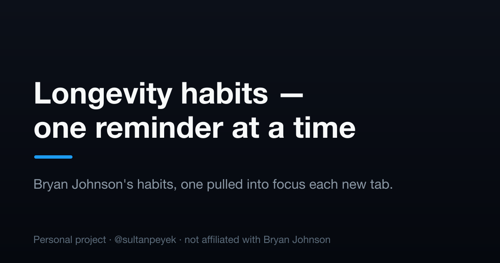

# Bryan Johnson longevity advice

A single-file web app that I open as a new-tab page. Each load shows one of the 42 longevity habits from Bryan Johnson's public X post, large and centered, so I act on one habit instead of scrolling past the whole list. On a phone the habits form an iOS-style glass wheel. Swipe to scroll, and on release the nearest line snaps under a fixed frosted lens.

Live: https://sultanpeyek.github.io/bryan-johnson-longevity/



> Unofficial personal project. It is not affiliated with, endorsed by, or sponsored by Bryan Johnson. The habits are quoted from his public post for commentary and educational purposes. See [DISCLAIMER.md](DISCLAIMER.md).

## Controls

| Action | Touch | Keyboard |
| --- | --- | --- |
| Random habit | "Pick another" button | `Space` or `Enter` |
| Step through | Flick left or right | `→` `↓` `j` to go forward, `←` `↑` `k` to go back |
| Focus a line | Tap it | None |
| Read all | "Show all" button | `Esc` or tap the backdrop |
| Toggle dark mode | Button at top left | None |

The lens stays fixed while the habits move, and a flick past either end rubber-bands. The floating controls fade when idle and return on any input. The theme choice is saved in `localStorage` under the key `theme`.

## Stack

- Plain HTML, CSS, and JavaScript in one `index.html`. There are no dependencies, framework, or build step.
- A service worker (`sw.js`) and a web manifest make it an installable PWA that works offline. The page loads network-first and falls back to the cached copy. Other assets load cache-first.

## Getting started

There is nothing to install. Serve the folder over HTTP so the service worker can register:

```bash
python3 -m http.server 8000
# open http://localhost:8000
```

## Project structure

```
index.html            App markup, styles, the list of habits, and all script
sw.js                 Service worker (cache name bj-longevity-v10)
manifest.webmanifest  PWA manifest
icon-192.png, icon-512.png, avatar.jpg, og.png, og.svg   Images
CONTEXT.md            Glossary of the project's terms
DISCLAIMER.md         Non-affiliation and quotation notice
```

## Deployment

GitHub Pages serves the repository root from the `main` branch. The `.nojekyll` file turns off Jekyll processing. Because the page is network-first, a new deploy reaches users without changing the cache name. Bump `CACHE` in `sw.js` only to flush old static assets.

## Credits and licence

Animation follows the principles of [Emil Kowalski](https://animations.dev/) and the [Vercel Web Interface Guidelines](https://vercel.com/design/guidelines).

The code and design are MIT licensed. See [LICENSE](LICENSE). The quoted habits remain their author's work. Built by [@sultanpeyek](https://github.com/sultanpeyek).
